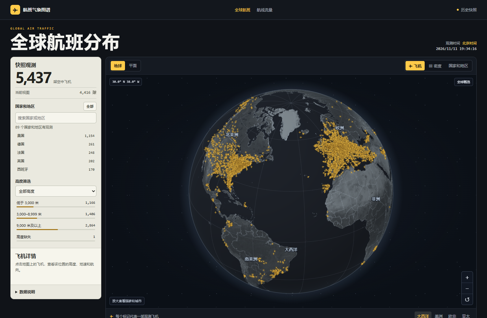
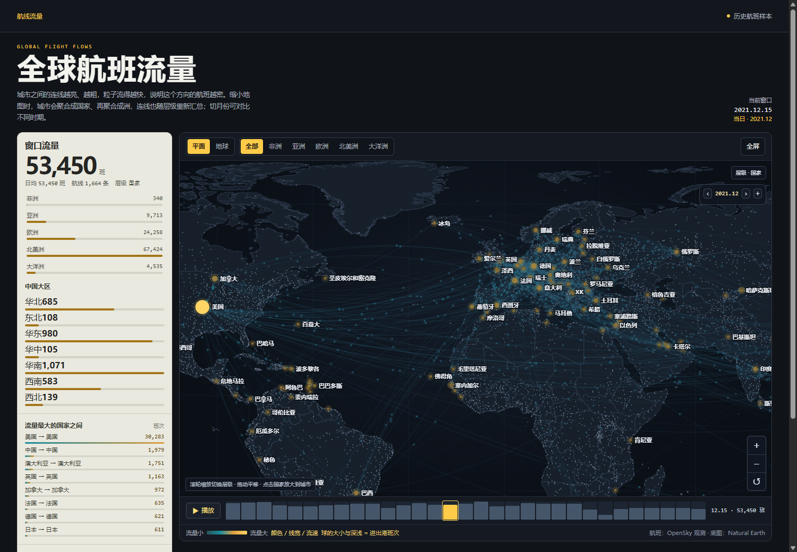

# 航班气象图谱

一个可以离线浏览的航空可视化项目。全球航班分布页把同一时刻的飞机画在地球上，航线流量页把一段时间内的航班按起降地汇总。前者适合观察哪些空域繁忙，后者适合比较哪些城市和国家之间往来频繁。

## 项目展示

### 全球航班分布

下图是 **2026 年 11 月 11 日 19:34:16（北京时间）** 的历史快照，包含 **5,437 架**空中飞机。拖动地球可以查看不同半球，点击飞机可以读取高度、地速和航向。切换到平面地图或 5° × 5° 密度网格，可以观察大范围的分布差异。



### 航线流量

在日历中选择日期，或播放时间轴查看航线的逐日变化。地图随缩放在洲、国家和城市之间切换。连线的亮度、宽度和移动粒子表示该方向的班次量。下图展示 **2021 年 12 月 15 日** 的样本。



## 快速开始

1. 在 GitHub 选择 **Code → Download ZIP** 并解压，也可以用 Git 克隆仓库。
2. 用近期版本的 Chrome 或 Edge 打开 `dist/global.html`。点击顶部的 **航线流量**，或直接打开 `dist/flow.html`。

两个 HTML 都内嵌了脚本、样式、底图和所需数据，下载后即可断网使用。若要通过本地 HTTP 服务浏览，在仓库根目录运行以下命令，然后打开 [全球航班分布](http://localhost:8000/global.html) 或 [航线流量](http://localhost:8000/flow.html)。

```bash
python -m http.server 8000 --bind 127.0.0.1 --directory dist
```

## 从源码构建

在仓库根目录运行以下命令即可重新生成两个页面。常规构建只使用 Python 3 标准库，已随仓库提供聚合数据。

```bash
python scripts/build.py
```

| 路径 | 内容 |
| --- | --- |
| `src/global.*`、`src/countries.js` | 全球航班地图、观测筛选与国家边界匹配 |
| `src/flow.*` | 流量地图、航线动画、日历与统计面板 |
| `data/global/` | 航班快照、国家边界、城市地名与地球纹理 |
| `data/global-flows.json` | 按日期和方向汇总的城市对、国家对航班量 |
| `scripts/` | 数据提取、地理数据预处理与离线页面构建 |
| `dist/` | 可以直接打开的 HTML 成品 |

若要从原始月表重新统计，请将对应的 OpenSky 月度清单 `flightlist_*.csv.gz` 放入 `data/opensky/`，运行 `python scripts/extract_global_flows.py --rescan`，再运行构建命令。月度清单和扫描缓存仅保存在本地。

## 数据来源与读图口径

- **空中位置**来自 OpenSky 历史快照，仅保留带有有效坐标、距最近一次位置报告不超过 60 秒的空中观测。国家和地区按观测坐标与陆地边界匹配，海上和未匹配位置单独统计。[OpenSky Network](https://opensky-network.org/)
- **航线流量**来自 OpenSky 月度航班清单。随仓库提供的数据涵盖 **2019 年 1–7 月及 2021 年 12 月**，共 243 天，含 1,566 个城市节点、127 个国家和地区节点。国家层汇总能匹配起降机场的航段，城市层只绘制筛选后的城市对。接收站覆盖会随地区和月份变化，跨月比较时应考虑这一差异。[OpenSky 历史数据](https://opensky-network.org/data/historical) · [OurAirports 机场表](https://ourairports.com/data/)
- **中国国内补充样本**取自 2015 年 1 月。程序按每月相同的日序重复叠加该样本，因此中国国内流量包含历史补样，无法据此推断相应年份的实际增减。
- **地理底图**使用 Natural Earth 的国家边界与城市地名，地球纹理来自 NASA Blue Marble。[Natural Earth](https://www.naturalearthdata.com/) · [NASA / GSFC](https://svs.gsfc.nasa.gov/2915/)
